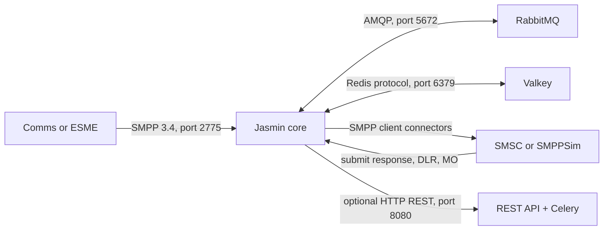

# Jasmin SMS Gateway on AlmaLinux

Production-minded installation and operations guide for Jasmin SMS Gateway installed from PyPI with `pip` on AlmaLinux. It covers RabbitMQ, Valkey, SMPP routing, billing, delivery receipts, MO traffic, and systemd startup. FastAPI appears only as an optional ESME test client.

> **Scope:** The commands are written for AlmaLinux 9 and Jasmin 0.11.1. Confirm package names on the target AlmaLinux minor release and test changes in staging. Jasmin's official installation page describes Python 3 but does not publish a precise supported Python minor-version matrix. This guide uses Python 3.11 as the conservative deployment target; do not interpret that as an upstream statement that every newer Python is incompatible. Jasmin 0.11.1 was installed and run in the lab under Python 3.12, although it emitted a `pkg_resources` deprecation warning.

## Contents

- [1. What this installs](#1-what-this-installs)
- [2. Architecture and service roles](#2-architecture-and-service-roles)
- [3. Requirements and network plan](#3-requirements-and-network-plan)
- [4. Install system dependencies](#4-install-system-dependencies)
- [5. Install Jasmin from PyPI in a virtual environment](#5-install-jasmin-from-pypi-in-a-virtual-environment)
- [6. Configure Jasmin dependencies](#6-configure-jasmin-dependencies)
- [7. Configure systemd services and one-command startup](#7-configure-systemd-services-and-one-command-startup)
- [8. Configure Jasmin through jCLI](#8-configure-jasmin-through-jcli)
- [9. Route MT messages to simulated SMSCs](#9-route-mt-messages-to-simulated-smscs)
- [10. Configure billing](#10-configure-billing)
- [11. Verify end-to-end delivery, DLRs, and MO messages](#11-verify-end-to-end-delivery-dlrs-and-mo-messages)
- [12. FastAPI ESME smoke test (optional)](#12-fastapi-esme-smoke-test-optional)
- [13. Troubleshooting from the AlmaLinux lab](#13-troubleshooting-from-the-almalinux-lab)
- [14. Security and production-readiness checklist](#14-security-and-production-readiness-checklist)
- [15. Useful commands and log files](#15-useful-commands-and-log-files)
- [16. Official references](#16-official-references)

## 1. What this installs

The resulting host runs Jasmin 0.11.1 from an isolated Python 3.11 virtual environment under `/opt/jasmin/venv`. RabbitMQ provides AMQP messaging and queueing. Valkey provides the Redis-compatible service Jasmin uses for message-ID/DLR mappings and related runtime data.

The guide uses AlmaLinux packages for RabbitMQ and Valkey where available, and `pip` for Jasmin. Jasmin's official guide documents PyPI installation and says RabbitMQ and Redis must be running. It also provides RPM installation for RHEL-family systems; PyPI is used here because that is the requested deployment method. [Official installation guide](https://docs.jasminsms.com/en/latest/installation/index.html)

Jasmin relies on several services. The systemd target later in this document provides a **single operator command** to start the stack, while each long-running daemon remains its own systemd process so it can be restarted and monitored independently.

## 2. Architecture and service roles



The **SMPP server** is the interface used by a downstream ESME (for example, Comms) to submit messages into Jasmin. Jasmin's **SMPP client connectors** are separate outbound sessions that connect from Jasmin to provider SMSCs or SMPPSim. MT and MO routes decide where messages go. RabbitMQ decouples submission, routing, and delivery. DLR processing uses message-ID mappings in Redis/Valkey and the DLR workers. [Architecture](https://docs.jasminsms.com/en/latest/architecture/) · [Messaging flow](https://docs.jasminsms.com/en/latest/messaging/index.html) · [Routing](https://docs.jasminsms.com/en/latest/routing/)

| Process/service | Purpose | Needed when |
|---|---|---|
| `jasmind.py` | Main Jasmin daemon: SMPP server, router, connector manager, HTTP API, jCLI and core broker clients | Always |
| `dlrlookupd.py` | Looks up the submission-to-SMSC-ID map when an upstream receipt arrives and forwards it to the right DLR delivery path | DLR support using the standalone daemon model |
| `dlrd.py` | DLR thrower daemon for configured receipt delivery paths | DLR support using the standalone daemon model |
| `deliversmd.py` | Delivers received MO `deliver_sm` messages through configured routes | MO delivery through the standalone daemon model |
| `interceptord.py` | Runs configured message interception scripts | Only when interceptors are used |
| `twistd ... --wsgi=jasmin.protocols.rest.api` | REST API web process | Only when using Jasmin REST API |
| Celery worker | Executes asynchronous tasks for the REST API | Only when using Jasmin REST API |

**Do not run duplicate implementations.** Depending on the launch flags and Jasmin release, the core can start some thrower/lookup components internally. If using the separate daemon services below, do not also enable the equivalent embedded components on `jasmind.py`. Check the installed version's `jasmind.py --help`, service files, startup logs, and process list before enabling components. Jasmin's Docker launch uses flags for native DLR thrower and lookup components; that is a different service layout from separate systemd helper daemons. [Jasmin Dockerfile](https://github.com/jookies/jasmin/blob/master/docker/Dockerfile)

## 3. Requirements and network plan

- AlmaLinux 9 (or a tested AlmaLinux 8/10 equivalent).
- Python 3.11, pip, compiler/build tools, Python headers, OpenSSL and libffi headers.
- RabbitMQ Server.
- Valkey Server, configured to listen on localhost unless shared storage is intentionally remote.
- A dedicated service account and persistent directories.
- Provider SMPP parameters for a real carrier, or SMPPSim credentials for a lab.

Typical ports (verify against `/etc/jasmin/jasmin.cfg` and local policy):

| Port | Direction | Use | Firewall guidance |
|---:|---|---|---|
| 2775/tcp | ESME/Comms → Jasmin | Jasmin SMPP server | Restrict source addresses; use private network/VPN where possible |
| 2776/tcp or provider port | Jasmin → SMSC | Outbound SMPP client session | Permit outbound traffic to approved peer |
| 5672/tcp | Jasmin → RabbitMQ | AMQP | Localhost/private network only |
| 6379/tcp | Jasmin → Valkey | Redis protocol | Localhost/private network only |
| jCLI port from config | Administrator → Jasmin | Management console | Bind to localhost or restrict to admin VPN/IPs |
| 1401/tcp | Application → Jasmin | Jasmin HTTP API, if enabled | Restrict access; use TLS termination/proxy for remote clients |
| 8080/tcp | Application → REST API | Separate REST service, if enabled | Restrict access; do not confuse with HTTP API on 1401 |

Avoid opening RabbitMQ, Valkey, or jCLI to the public internet. Confirm actual listening ports with `ss -lntp` after configuration.

## 4. Install system dependencies

### 4.1 Update and enable required repositories

```bash
sudo dnf update -y
sudo dnf install -y epel-release
sudo dnf config-manager --set-enabled crb || true
sudo dnf makecache
```

Repository availability varies by AlmaLinux release and mirror. Check before installing:

```bash
dnf info python3.11 python3.11-pip valkey rabbitmq-server
```

Install packages (adjust package names if the enabled AlmaLinux repositories use different names):

```bash
sudo dnf install -y \
  python3.11 python3.11-pip python3.11-devel \
  gcc gcc-c++ make redhat-rpm-config \
  libffi-devel openssl-devel \
  valkey rabbitmq-server \
  policycoreutils-python-utils firewalld
```

Python 3.11 is available as a versioned package suite in RHEL 9; keep the OS's system Python unchanged. Do not repoint `/usr/bin/python` or `/usr/bin/python3` to the new interpreter. [RHEL Python versions](https://docs.redhat.com/en/documentation/red_hat_enterprise_linux/9/html/installing_and_using_dynamic_programming_languages/assembly_installing-and-using-python_installing-and-using-dynamic-programming-languages)

Enable and start the supporting services:

```bash
sudo systemctl enable --now valkey rabbitmq-server
systemctl is-active valkey rabbitmq-server
valkey-cli -h 127.0.0.1 -p 6379 ping
sudo rabbitmq-diagnostics -q ping
```

Expected checks: `active` for both systemd units, `PONG` from Valkey, and a successful RabbitMQ diagnostic. If RabbitMQ is installed from its upstream repository rather than AlmaLinux repositories, follow RabbitMQ's Alma/RHEL installation guide and package-signing instructions. Do not install a second Redis service beside Valkey without deciding explicitly which endpoint Jasmin should use.

### 4.2 Create the Jasmin service account and directories

```bash
sudo groupadd --system jasmin 2>/dev/null || true
sudo useradd --system --gid jasmin --home-dir /opt/jasmin \
  --create-home --shell /sbin/nologin jasmin 2>/dev/null || true

sudo install -d -o root -g jasmin -m 0750 /opt/jasmin
sudo install -d -o jasmin -g jasmin -m 0750 /opt/jasmin/venv
sudo install -d -o root -g jasmin -m 0750 /etc/jasmin
sudo install -d -o root -g jasmin -m 0750 /etc/jasmin/resource
sudo install -d -o jasmin -g jasmin -m 0750 /etc/jasmin/store
sudo install -d -o jasmin -g jasmin -m 0750 /var/log/jasmin
```

The service account owns mutable state and log directories. Configuration and secrets should be writable only by root and readable by the `jasmin` group as needed. The Jasmin PyPI installation guide identifies `/etc/jasmin`, `/etc/jasmin/resource`, `/etc/jasmin/store`, and `/var/log/jasmin` as required service paths. [PyPI installation instructions](https://docs.jasminsms.com/en/latest/installation/index.html#pypi)

## 5. Install Jasmin from PyPI in a virtual environment

Use an isolated virtual environment so Jasmin dependencies do not change AlmaLinux's system Python or collide with FastAPI's environment.

```bash
sudo -u jasmin python3.11 -m venv /opt/jasmin/venv
sudo -u jasmin /opt/jasmin/venv/bin/python -m pip install --upgrade pip wheel
sudo -u jasmin /opt/jasmin/venv/bin/python -m pip install 'jasmin==0.11.1'
sudo -u jasmin /opt/jasmin/venv/bin/python -m pip freeze \
  | sudo tee /opt/jasmin/requirements-lock.txt >/dev/null
sudo chmod 0640 /opt/jasmin/requirements-lock.txt
sudo chown root:jasmin /opt/jasmin/requirements-lock.txt
```

Verify that the entry points are in the expected environment:

```bash
/opt/jasmin/venv/bin/python --version
/opt/jasmin/venv/bin/python -m pip show jasmin
for name in jasmind.py dlrlookupd.py dlrd.py deliversmd.py interceptord.py celery twistd; do
  test -x "/opt/jasmin/venv/bin/$name" && echo "OK $name" || echo "Not installed: $name"
done
```

Do not use a bare `pip install` when several virtual environments exist. Always invoke pip through the exact interpreter: `/opt/jasmin/venv/bin/python -m pip ...`. Keep the lock file with deployment records so the environment can be rebuilt reproducibly.

Copy the configuration templates from the installed Jasmin distribution/release into `/etc/jasmin`, rather than inventing a new config file. Depending on the pip release, templates may be in the source distribution or the upstream Git repository:

```bash
# In a controlled build/staging environment, obtain templates for the SAME Jasmin tag.
# Review the release before copying; do not blindly overwrite a live configuration.
```

At minimum, the runtime needs `jasmin.cfg` and resource XML under `/etc/jasmin/resource`. Optional services use their matching files, commonly `dlr.cfg`, `dlrlookupd.cfg`, `deliversm.cfg`, `interceptor.cfg`, and REST API configuration. Compare templates from the matching `0.11.1` tag, not an unrelated `master` branch. [Jasmin source configuration](https://github.com/jookies/jasmin/tree/master/misc/config)

## 6. Configure Jasmin dependencies

### 6.1 RabbitMQ

Jasmin's default local RabbitMQ configuration commonly uses AMQP at `127.0.0.1:5672`, virtual host `/`, and development credentials. For a real deployment, create a dedicated RabbitMQ user and vhost rather than relying on the default `guest` account. The RabbitMQ `guest` user is generally restricted to local connections.

Example:

```bash
sudo rabbitmqctl add_vhost /jasmin
sudo rabbitmqctl add_user jasmin_broker 'REPLACE_WITH_A_LONG_UNIQUE_SECRET'
sudo rabbitmqctl set_permissions -p /jasmin jasmin_broker '.*' '.*' '.*'
```

Set the corresponding values in the `[amqp-broker]` section of `/etc/jasmin/jasmin.cfg`:

```ini
[amqp-broker]
host = 127.0.0.1
port = 5672
vhost = /jasmin
username = jasmin_broker
password = REPLACE_WITH_A_LONG_UNIQUE_SECRET
```

If storing a literal secret in the config file is required, protect it:

```bash
sudo chown root:jasmin /etc/jasmin/jasmin.cfg
sudo chmod 0640 /etc/jasmin/jasmin.cfg
```

### 6.2 Valkey (Redis-compatible endpoint)

Jasmin expects a Redis-compatible service for its Redis client. On this AlmaLinux deployment, Valkey provides that service. Jasmin's own documentation names Redis; it does not provide a Valkey-specific compatibility guarantee. Treat Valkey as a tested dependency for this installation and verify startup, DLR mapping, and billing in staging before production.

Check and configure the Valkey endpoint:

```bash
sudo valkey-cli CONFIG GET bind
sudo valkey-cli CONFIG GET port
sudo valkey-cli CONFIG GET requirepass
```

In `/etc/jasmin/jasmin.cfg`, configure `[redis-client]` to match Valkey. For a local service without authentication:

```ini
[redis-client]
host = 127.0.0.1
port = 6379
dbid = 0
password = None
```

If Valkey authentication is enabled, configure the matching password and ensure the Valkey ACL/user permits the Redis commands Jasmin requires. Keep Valkey bound to localhost or a private interface and protect data persistence according to the deployment's recovery requirements. A successful `PING` alone verifies reachability, not all Jasmin workflows.

### 6.3 Configuration files and jCLI authentication

Review `/etc/jasmin/jasmin.cfg` before starting Jasmin. Important sections include `[amqp-broker]`, `[redis-client]`, `[smpp-server]`, `[http-api]`, `[jcli]`, and `[client-management]`. Configuration names and defaults should be taken from the 0.11.1 template installed for the service.

Set strong, unique administrator credentials. The SMPP server user accounts created through jCLI are separate from the jCLI administrator account. Do not place production passwords in shell history or paste them into tickets. If a daemon accepts credentials as command-line parameters, process listings can expose them; prefer the protected configuration mechanism supported by the installed version.

The jCLI port should be bound to loopback or a management interface reachable only through an admin VPN. jCLI configuration changes are runtime state until persisted. [jCLI overview](https://docs.jasminsms.com/en/latest/management/jcli/) · [jCLI persistence](https://docs.jasminsms.com/en/latest/management/jcli/index.html)

## 7. Configure systemd services and one-command startup

### 7.1 Why a target is used

`jasmin-stack.target` is a systemd grouping unit. An operator starts the target once; systemd then starts the enabled core and helper services in dependency order. It does not turn multiple daemons into one process. This preserves service-level logs, restart behavior, and status checks.

First check whether the installed PyPI package or your host already has upstream service files:

```bash
find /usr/lib/systemd/system /etc/systemd/system -maxdepth 1 -type f \
  -iname '*jasmin*' -print 2>/dev/null
```

If upstream Jasmin service files exist, review and adapt their `ExecStart`, user, working directory, and Python paths. Do not install another unit with the same service name. The upstream distribution includes separate units for core, REST API, Celery, DLR lookup, DLR thrower, MO delivery, and interceptor services. [Upstream unit directory](https://github.com/jookies/jasmin/tree/master/misc/config/systemd)

The following example assumes these scripts exist in `/opt/jasmin/venv/bin/` and that separate helper daemons are the selected service model. Confirm each command's options with `--help` before enabling it.

### 7.2 Core service

Create `/etc/systemd/system/jasmin-core.service`:

```ini
[Unit]
Description=Jasmin SMS Gateway core
Wants=network-online.target
After=network-online.target valkey.service rabbitmq-server.service
Requires=valkey.service rabbitmq-server.service

[Service]
Type=simple
User=jasmin
Group=jasmin
WorkingDirectory=/etc/jasmin
ExecStart=/opt/jasmin/venv/bin/jasmind.py
Restart=on-failure
RestartSec=5
TimeoutStartSec=90
TimeoutStopSec=45
KillSignal=SIGTERM
UMask=0027
LimitNOFILE=65536
NoNewPrivileges=true
PrivateTmp=true

[Install]
WantedBy=jasmin-stack.target
```

If the installed daemon requires startup arguments, use the exact syntax shown by `/opt/jasmin/venv/bin/jasmind.py --help` and avoid putting reusable secrets directly in arguments. Configure its bind, ports, and auth in `jasmin.cfg` where supported.

### 7.3 Standalone helper units

Create `/etc/systemd/system/jasmin-worker@.service`:

```ini
[Unit]
Description=Jasmin %I daemon
Wants=network-online.target
After=network-online.target jasmin-core.service
Requires=jasmin-core.service
PartOf=jasmin-stack.target

[Service]
Type=simple
User=jasmin
Group=jasmin
WorkingDirectory=/etc/jasmin
ExecStart=/opt/jasmin/venv/bin/%i
Restart=on-failure
RestartSec=10
TimeoutStopSec=45
UMask=0027
LimitNOFILE=65536
NoNewPrivileges=true
PrivateTmp=true

[Install]
WantedBy=jasmin-stack.target
```

The instance name is the executable, so start only the helper daemons needed by this installation:

```bash
sudo systemctl enable jasmin-worker@dlrlookupd.py.service
sudo systemctl enable jasmin-worker@dlrd.py.service
sudo systemctl enable jasmin-worker@deliversmd.py.service
```

If message interceptors are configured, enable `jasmin-worker@interceptord.py.service` as well. If no interceptors are used, leave it disabled. Do not create a unit for an executable that is absent from the venv.

> **Important service model check:** If the `jasmind.py` options enable embedded DLR lookup/thrower services, omit the matching standalone worker(s). Each worker uses a singleton lock; a second copy exits with `Lock not acquired ! exiting`. Do not try to fix a duplicate process by deleting its lock file while a service may still be running.

### 7.4 Optional REST API and Celery units

The FastAPI lab used SMPP directly and did not require these. Enable these two services only if applications use Jasmin's separate REST API.

`/etc/systemd/system/jasmin-restapi.service`:

```ini
[Unit]
Description=Jasmin REST API WSGI server
After=network-online.target jasmin-core.service
Requires=jasmin-core.service
PartOf=jasmin-stack.target

[Service]
Type=simple
User=jasmin
Group=jasmin
WorkingDirectory=/etc/jasmin
ExecStart=/opt/jasmin/venv/bin/twistd -n --pidfile=/run/jasmin-restapi.pid web --wsgi=jasmin.protocols.rest.api
Restart=on-failure
RestartSec=5
RuntimeDirectory=jasmin
RuntimeDirectoryMode=0750
UMask=0027
NoNewPrivileges=true
PrivateTmp=true

[Install]
WantedBy=jasmin-stack.target
```

`/etc/systemd/system/jasmin-celery.service`:

```ini
[Unit]
Description=Jasmin REST API Celery worker
After=network-online.target rabbitmq-server.service jasmin-core.service
Requires=rabbitmq-server.service jasmin-core.service
PartOf=jasmin-stack.target

[Service]
Type=simple
User=jasmin
Group=jasmin
WorkingDirectory=/etc/jasmin
ExecStart=/opt/jasmin/venv/bin/celery -A jasmin.protocols.rest.tasks worker --loglevel=INFO --autoscale=10,3
Restart=on-failure
RestartSec=5
TimeoutStopSec=60
UMask=0027
NoNewPrivileges=true
PrivateTmp=true

[Install]
WantedBy=jasmin-stack.target
```

If using a fixed Celery worker count, replace `--autoscale=10,3` with a tested `--concurrency=N`; do not specify both unless the installed Celery version's behavior is understood. Check REST API and Celery configuration (often `/etc/jasmin/rest-api.py.conf`) for broker URL, bind address, and port. The REST API is separate from Jasmin's HTTP API on port 1401. [REST API docs](https://docs.jasminsms.com/en/latest/apis/rest/)

### 7.5 Aggregate target and startup

Create `/etc/systemd/system/jasmin-stack.target`:

```ini
[Unit]
Description=Jasmin SMS Gateway stack
Wants=network-online.target valkey.service rabbitmq-server.service
Wants=jasmin-core.service
Wants=jasmin-worker@dlrlookupd.py.service
Wants=jasmin-worker@dlrd.py.service
Wants=jasmin-worker@deliversmd.py.service
# Add these only when needed:
# Wants=jasmin-worker@interceptord.py.service
# Wants=jasmin-restapi.service jasmin-celery.service
After=network-online.target valkey.service rabbitmq-server.service

[Install]
WantedBy=multi-user.target
```

Apply and start the stack:

```bash
sudo systemctl daemon-reload
sudo systemctl enable --now jasmin-stack.target
systemctl status jasmin-stack.target jasmin-core.service --no-pager
systemctl is-active valkey rabbitmq-server jasmin-core
```

The `Wants=` list is the one place to choose the daemons that start with the stack. Add REST and Celery only if you run the REST API. Add interceptord only if required. To stop/restart the complete group:

```bash
sudo systemctl stop jasmin-stack.target
sudo systemctl start jasmin-stack.target
```

`PartOf=jasmin-stack.target` on helper services propagates stop/restart operations from the target. A target is an aggregate, not a shell script; inspect the individual service statuses if startup fails.

### 7.6 SELinux and service paths

Keep executable environments outside `/root`. In the lab, systemd could not execute `/root/jasmin-venv/bin/jasmind.py`: SELinux was enforcing and denied execution of the `admin_home_t` file label. Moving Jasmin to `/opt/jasmin/venv` resolved the execute denial. Do not disable SELinux to work around this class of problem.

Check paths and labels:

```bash
namei -l /opt/jasmin/venv/bin/jasmind.py
ls -lZ /opt/jasmin/venv/bin/jasmind.py
getenforce
sudo ausearch -m AVC,USER_AVC -ts recent | tail -n 40
```

If SELinux still blocks a service, inspect AVC records and label the narrow path correctly; do not generate and install broad `audit2allow` rules without review. Do not move executables into a `noexec` mount.

## 8. Configure Jasmin through jCLI

Connect to the configured jCLI port from localhost or the management VPN. Do not expose it publicly.

### 8.1 Create a group and SMPP ESME user

In jCLI (password prompts omitted):

```text
group -a
> gid comms-esme
> ok

user -a
> uid comms-esme-prod
> username comms-esme
> password <unique SMPP bind secret>
> gid comms-esme
> mt_messaging_cred authorization smpps_send True
> mt_messaging_cred quota balance 100000
> mt_messaging_cred quota submit_sm_count 100000
> mt_messaging_cred quota smpps_throughput 20
> ok
```

The exact quota names and supported values depend on the installed version; use `help user` in jCLI and inspect `user -s <uid>` before using this example. The values above are lab placeholders, not a recommended production limit. Create one SMPP account per calling system/environment, use a distinct password, and set source-address and destination restrictions deliberately.

### 8.2 Configure an upstream SMPP client connector

For a carrier or SMPPSim, use the actual peer's credentials and port:

```text
smppccm -a
> cid smsc_mtn
> host <SMSC_HOST_OR_PRIVATE_IP>
> port <SMPP_PORT>
> username <SMSC_SYSTEM_ID>
> password <SMSC_PASSWORD>
> submit_throughput <AGREED_SMS_PER_SECOND>
> bind transceiver
> ok

smppccm -1 smsc_mtn
smppccm -l
```

`BOUND_TRX` indicates a transceiver bind succeeded. It does not by itself prove message routing, delivery, or DLR processing. Read the connector log under `/var/log/jasmin/` and monitor `stats --smppc smsc_mtn`. [Connector setup](https://docs.jasminsms.com/en/latest/installation/index.html#adding-smpp-connection)

### 8.3 Persist runtime configuration

After validating configuration, save it:

```text
persist
```

Jasmin keeps router, user, filter, and connector configuration in runtime memory and persists it to profiles in `/etc/jasmin/store`. Verify those files are present and included in backups. After restarting, confirm the expected profile loaded and connectors are started. [jCLI persistence](https://docs.jasminsms.com/en/latest/management/jcli/)

## 9. Route MT messages to simulated SMSCs

Use distinct destination filters and route priorities. Jasmin tests routes in descending order; a broader higher-priority filter can shadow a more specific route. The examples below use lab number ranges only; replace them with carrier-approved numbering plans and validate against current number portability data in production.

```text
filter -a
> fid mt_mtn
> type DestinationAddrFilter
> destination_addr ^25677[0-9]{7}$
> ok

filter -a
> fid mt_airtel
> type DestinationAddrFilter
> destination_addr ^25670[0-9]{7}$
> ok

mtrouter -a
> type StaticMTRoute
> order 100
> filters mt_mtn
> connector smppc(smsc_mtn)
> rate 0
> ok
```

Repeat with unique route order and connector/filter for each simulator/provider. List and inspect before sending:

```text
filter -l
mtrouter -l
```

Route order matters: use the highest order for the narrowest intended route and avoid overlapping filters unless fallback behavior is intentional. Configure an explicit fallback route only if the business rules define what should happen to unmatched numbers. Do not silently route unmatched traffic to a carrier. [Routing and order](https://docs.jasminsms.com/en/latest/routing/)

## 10. Configure billing

Jasmin bills using the **rate on the MT route** and the user's balance/quota. Newly added routes may have rate `0` unless you explicitly set one. A route with rate `0` does not demonstrate paid billing. Use test units such as credits, not real currency, in the simulator lab. [Jasmin billing](https://docs.jasminsms.com/en/latest/billing/)

Example route rate (illustrative test credits per message):

```text
mtrouter -a
> type StaticMTRoute
> order 100
> filters mt_mtn
> connector smppc(smsc_mtn)
> rate 2.5
> ok
```

Before testing, give the test user a balance greater than the expected send charges. Check `user -s <uid>`, `stats --user <uid>`, and the route listing. Confirm how multipart SMS are rated in the exact Jasmin release and compare message parts versus debits. Do not use the SMSC `submit_sm_resp` as proof of handset delivery: it means the next hop accepted the submission; the DLR carries a later delivery state.

## 11. Verify end-to-end delivery, DLRs, and MO messages

Use a controlled test destination that matches exactly one route.

1. Check dependencies: `systemctl is-active valkey rabbitmq-server jasmin-core`.
2. Check connectors: `smppccm -l`; each intended simulator should show `BOUND_TRX`.
3. Check route selection: `mtrouter -l`, `filter -l`.
4. Submit a single MT message through an ESME account.
5. Check Jasmin: `stats --smppc <cid>`, `stats --user <uid>`, and `/var/log/jasmin/messages.log`.
6. Wait for the simulator DLR and verify `dlrlookupd`, `dlrd`, and ESME receipt delivery logs.
7. Inject an MO from the simulator and verify a matching MO route exists and that the receiving SMPP session or HTTP connector gets the message.
8. Persist verified configuration with `persist`, restart the target during a maintenance window, and repeat the checks.

Example log search:

```bash
sudo grep -F '<JASMIN_QUEUE_MESSAGE_ID>' /var/log/jasmin/messages.log
sudo tail -n 100 /var/log/jasmin/dlrlookupd-messages.log
sudo tail -n 100 /var/log/jasmin/dlr-thrower.log
sudo journalctl -u jasmin-core.service -n 100 --no-pager
```

The lab successfully delivered MT messages to SMPPSim through separate routes for simulated MTN, Airtel, and Safaricom prefixes. Example evidence was a `messages.log` record containing the expected `[cid:<connector>]`, an accepted submit response, and a later DLR stored against the FastAPI lab's local message ID. Validate connector identity in logs: an HTTP 200 alone does not prove which carrier route was selected.

## 12. FastAPI ESME smoke test (optional)

FastAPI was used as a lab ESME to bind to Jasmin over SMPP and send test messages. It is not required to install or run Jasmin. Configure the test application with the Jasmin server address, port `2775`, the SMPP username/password created in jCLI, and a separate application API key. If FastAPI runs on the same host, `127.0.0.1:2775` is appropriate; from another host, use Jasmin's private address and firewall allow-list.

Example request (adapt endpoint and JSON to the lab app):

```bash
curl -sS -X POST 'http://127.0.0.1:8000/sms/smpp' \
  -H "X-API-Key: $APP_API_KEY" \
  -H 'Content-Type: application/json' \
  -d '{"to":"256771234567","sender":"Lab","content":"test","request_dlr":true}'
```

An accepted SMPP response indicates Jasmin accepted the message from the ESME. Verify the outbound connector and DLR separately. An MO test also requires a Jasmin MO route; establishing a receiver bind alone does not route inbound messages to the application.

## 13. Troubleshooting from the AlmaLinux lab

### `RuntimeError: Set APP_API_KEY before starting the application`

The FastAPI app reads process environment variables; it does not automatically read `.env` unless configured to do so. Load the environment in the same shell before starting Uvicorn, or configure a proper systemd `EnvironmentFile=`. This is an application issue, not a Jasmin SMPP credential error.

### SMPP receiver reports `Invalid Password`

The ESME credentials must match a Jasmin SMPP server account, not the jCLI administrator or an outbound SMSC connector. Verify the account in `user -s <uid>`, confirm the FastAPI process loaded the intended `.env`, and test an isolated bind. Passwords are case-sensitive; compare lengths or hashes, never print the secret into shared logs.

### FastAPI `/sms/rest` returns 502 / `curl` to port 8080 refuses

The Jasmin REST API is a separate WSGI service and requires a Celery worker. It is not automatically started just because `jasmind.py` is running. The Jasmin HTTP API on port 1401 is a different service/interface. Check `jasmin-restapi.service`, `jasmin-celery.service`, their logs, configured bind port, and whether the application targets the correct API.

### MO callback returns 403 or 400

403 indicates callback authentication token mismatch. Ensure the token in Jasmin's HTTP connector URL exactly matches the FastAPI callback configuration. A 400 can indicate the route was reached but the handler rejected the request body/format. Inspect the callback log and actual request fields. For SMPP MO, verify an MO route and the expected receiver bind, not the HTTP callback token.

### No MO/DLR events despite `deliver_sm_count` increasing

SMSC `deliver_sm_count` proves a PDU was exchanged on that connection, but it does not prove the application stored an event. Check the direction, DLR lookup log, DLR thrower log, user bind status, MO route table, and application callback/event store. For DLR over SMPP, the originating ESME needs an active receiver or transceiver bind and a request for delivery receipts. For MO, the inbound connector needs a matching `morouter` route.

### `DLRMapNotFound: Got a DLR for an unknown message id: 0` (or `1`, `2`)

SMPPSim returned small numeric IDs while Jasmin's mapping expected IDs that could be correlated to the submit response. Older simulator tests produced unknown-map errors. Check whether the simulator's submit response and DLR report the same message ID; use UUID-style IDs if the simulator supports them. Also confirm Valkey remained available between submit and DLR and that `dlrlookupd` is the only intended lookup process.

### `AttributeError: 'SubmitSM' object has no attribute 'response'` in Jasmin logs

This appeared in the lab with an SMPPSim receipt/response sequence. Check exact Jasmin and simulator versions, and compare the raw SMPP PDUs and connector debug log. A later test produced valid DLRs once simulator IDs and processes were stable. Do not patch Jasmin internals based solely on this message; first reproduce with a single message and inspect the send response, DLR lookup, and simulator logs.

### SMPP connector stuck at `BOUND_TRX_PENDING`, `stopped`, or bind timeout

Check address/port mapping first. The lab's original simulator container mapped host port `2776` to container port `2775`; Jasmin must connect to the host-side reachable address and port, not blindly to `2775`. Verify `podman ps`, `podman logs <container>`, and from the Jasmin host `nc -vz <simulator-host> <port>`. Then verify system_id/password and bind mode. A TCP connection alone is not a successful SMPP bind.

### SMPP response status 11 (`ESME_RINVSRCADR`) and empty SMSC message ID

Status 11 is an SMPP rejection, so a successful SMSC message ID may not exist. In the lab, a destination did not match a configured route or a route/filter was duplicated/misordered; after fixing the route and setting a non-zero test rate where needed, successful submissions returned IDs. Inspect `mtrouter -l`, `filter -l`, user destination permissions, and `/var/log/jasmin/messages.log`. Treat rejected/unknown submissions accurately; never synthesize an SMSC ID.

### Duplicate jCLI operation IDs in FastAPI OpenAPI

The FastAPI demo registered GET and POST handlers under duplicate operation identifiers for the same callback function. It is an OpenAPI schema warning, not evidence that Jasmin SMPP is broken. Assign unique `operation_id` values or separate route function names when maintaining the FastAPI sample.

### systemd: `Permission denied` executing `/root/.../jasmind.py`

The lab had SELinux enforcing and an AVC denial for the executable's `admin_home_t` label under `/root`. Put the venv under `/opt/jasmin`, use absolute paths in units, inspect `ausearch`/`ls -Z`, and retain SELinux enforcing. Do not use `chmod 777` or disable SELinux as a fix.

### `Lock not acquired ! exiting` from Jasmin or a helper daemon

The same daemon ID was already running, or an older process/service was holding its lock. The lab had `/tmp/dlrlookupd-master.lock` and `/tmp/dlrd-master.lock`; restarting multiple systemd instances rapidly caused repeated start failures. Stop all relevant systemd units and manually started processes, confirm `pgrep -af 'jasmind|dlrlookupd|dlrd|deliversmd'` is clean, then inspect lock files. Remove a stale lock only after confirming no process owns it. Reset the systemd start limit after fixing the cause:

```bash
sudo systemctl stop jasmin-stack.target
pgrep -af 'jasmind.py|dlrlookupd.py|dlrd.py|deliversmd.py' || true
sudo systemctl reset-failed 'jasmin-worker@*'
sudo systemctl start jasmin-stack.target
```

Do not remove lock files while a Jasmin daemon may be active: an open process can still hold the lock on an unlinked inode, allowing another instance to start unexpectedly.

### `celery`/`twistd`/`httpx` missing

This usually means commands were run from the Jasmin venv when the dependency belonged to FastAPI, or vice versa. Jasmin and FastAPI should use separate virtual environments. Inspect `command -v`, `python -m pip show`, and run the executable by absolute path from the correct venv.

### jCLI route/filter configuration disappears after restart

Run `persist` after successful configuration, check `/etc/jasmin/store` ownership and profile files, and inspect startup logs for the loaded profile. Back up the store directory and `jasmin.cfg` before maintenance.

## 14. Security and production-readiness checklist

- [ ] Pin Jasmin and all Python dependencies; maintain a lock file and test upgrades on a staging copy.
- [ ] Use a dedicated non-login service account; keep executable files and venv under `/opt`, not `/root`.
- [ ] Keep SELinux enforcing; investigate AVC denials narrowly.
- [ ] Use dedicated RabbitMQ user/vhost and Valkey authentication/ACLs as appropriate.
- [ ] Bind private services to localhost/private addresses; limit ingress with host/cloud firewalls.
- [ ] Store credentials in protected config/secret-management; rotate defaults and demo keys.
- [ ] Restrict jCLI; back up config and `/etc/jasmin/store` with protected permissions.
- [ ] Set SMPP throughput and bind limits according to provider agreements; monitor throttling and reconnects.
- [ ] Define explicit MT/MO routes, fallback policy, DLR behavior, and message validity policy.
- [ ] Validate billing for single-part and multipart messages; reconcile user debit events.
- [ ] Monitor RabbitMQ queue depth, Valkey availability, SMPP binds, DLR latency, worker restarts, disk space, and CPU/memory.
- [ ] Test broker/Valkey restart, Jasmin restart, provider disconnect, DLR delay, duplicate DLR, and queue recovery in staging.
- [ ] Confirm legal and carrier requirements for sender IDs, opt-in, content, and throughput before real traffic.
- [ ] Do not call a simulator test “production ready”; obtain carrier UAT credentials and run a controlled pilot before bulk launch.

## 15. Useful commands and log files

```bash
# Services
systemctl status jasmin-stack.target jasmin-core.service --no-pager
systemctl is-active valkey rabbitmq-server jasmin-core
journalctl -u jasmin-core.service -f
journalctl -u 'jasmin-worker@*.service' -f

# Processes and listeners
pgrep -af 'jasmind.py|dlrlookupd.py|dlrd.py|deliversmd.py|interceptord.py|celery|twistd' || true
sudo ss -lntp

# Broker/cache
valkey-cli -h 127.0.0.1 -p 6379 ping
sudo rabbitmq-diagnostics -q ping
sudo rabbitmqctl list_queues -p /jasmin name messages consumers

# Python environment
/opt/jasmin/venv/bin/python --version
/opt/jasmin/venv/bin/python -m pip show jasmin
/opt/jasmin/venv/bin/python -m pip check
```

Key logs (actual names depend on configuration):

| File/log | What it helps diagnose |
|---|---|
| `/var/log/jasmin/messages.log` | MT/MO queuing, selected connector, SMPP response, message state |
| `/var/log/jasmin/default-<CID>.log` | SMPP connection, bind, keepalive, submit and DLR traffic for a connector |
| `/var/log/jasmin/dlrlookupd-messages.log` | DLR mapping and unknown message-ID errors |
| `/var/log/jasmin/dlr-thrower.log` | DLR delivery attempts and failures |
| `/var/log/jasmin/deliversm-thrower.log` | MO delivery attempts and failures |
| `journalctl -u <unit>` | Service startup, exit status, lock conflicts, permissions |
| `ausearch -m AVC,USER_AVC -ts recent` | SELinux denials |

## 16. Official references

- [Jasmin installation (PyPI, dependencies, example connector)](https://docs.jasminsms.com/en/latest/installation/index.html)
- [Jasmin architecture](https://docs.jasminsms.com/en/latest/architecture/)
- [Jasmin messaging flows](https://docs.jasminsms.com/en/latest/messaging/index.html)
- [Jasmin routing](https://docs.jasminsms.com/en/latest/routing/)
- [Jasmin billing](https://docs.jasminsms.com/en/latest/billing/)
- [Jasmin REST API](https://docs.jasminsms.com/en/latest/apis/rest/)
- [Jasmin SMPP Server API](https://docs.jasminsms.com/en/latest/apis/smpp-server/)
- [Jasmin jCLI](https://docs.jasminsms.com/en/latest/management/jcli/)
- [Jasmin upstream systemd templates](https://github.com/jookies/jasmin/tree/master/misc/config/systemd)
- [RHEL 9 Python versions and packages](https://docs.redhat.com/en/documentation/red_hat_enterprise_linux/9/html/installing_and_using_dynamic_programming_languages/assembly_installing-and-using-python_installing-and-using-dynamic-programming-languages)

---

**Maintenance note:** Keep this guide aligned with the exact Jasmin release, AlmaLinux release, Python interpreter, and systemd units deployed. Re-run the staging acceptance checks after changing any of them.
